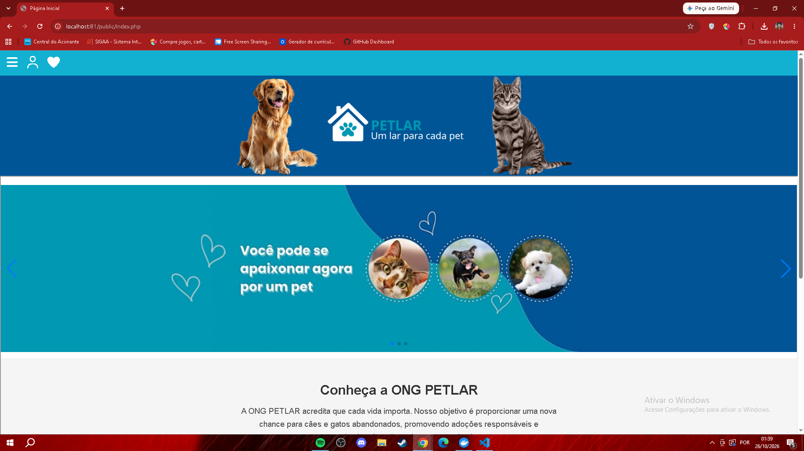
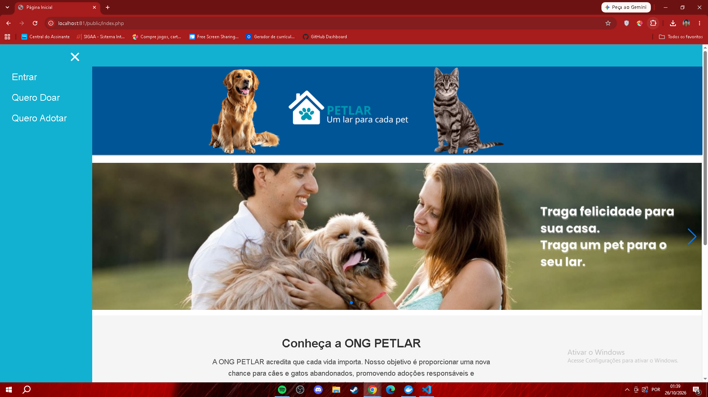
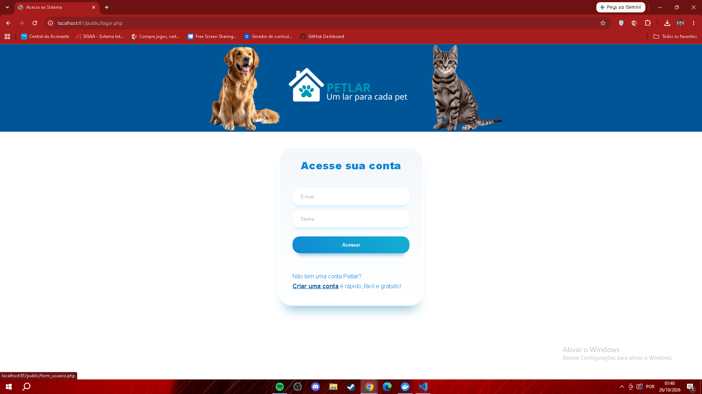
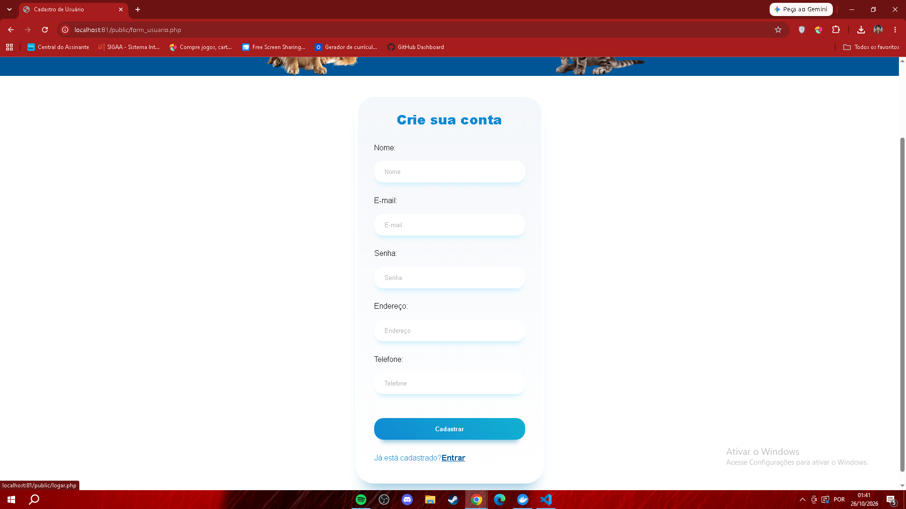
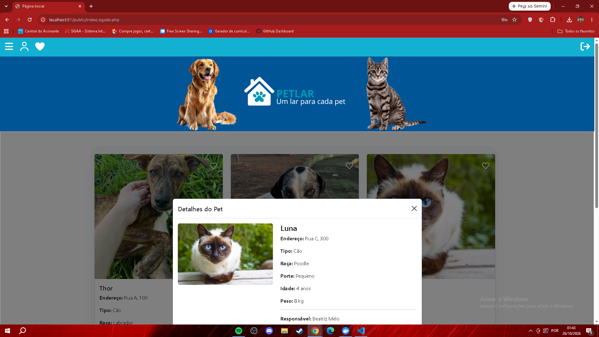
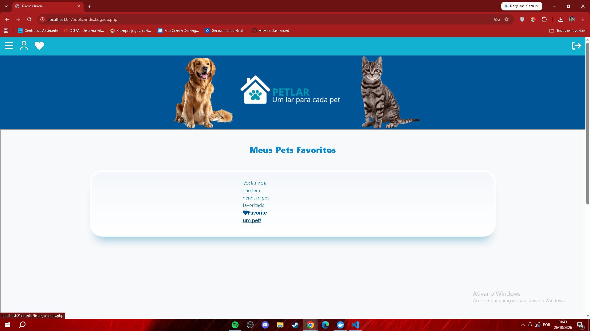
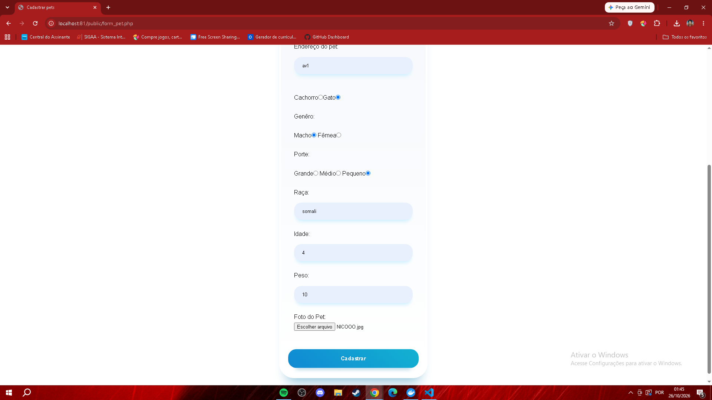

# ONG PetLar 

**Trabalho de Conclusão de Curso (TCC) — 3º ano do Ensino Médio Integrado ao Técnico em Informática para Internet | IF Goiano**

O **PetLar** é uma aplicação web desenvolvida como Trabalho de Conclusão de Curso (TCC) do Técnico em Informática para Internet, integrado ao ensino médio no Instituto Federal Goiano.

O projeto foi criado com o objetivo de apoiar a divulgação de animais vinculados a uma ONG, permitindo o gerenciamento de cadastros e a interação dos usuários com as informações dos animais.

> **Contexto acadêmico:** este repositório preserva o projeto desenvolvido durante minha formação técnica. O sistema não é mantido atualmente e não foi preparado para utilização em produção.

## Funcionalidades

- Cadastro e autenticação de usuários;
- Gerenciamento do perfil de usuário;
- Cadastro, listagem, edição e exclusão de animais;
- Visualização de informações individuais dos animais;
- Sistema de favoritos;
- Pesquisa e filtragem de animais;
- Gerenciamento dos animais cadastrados pelo usuário.

## Tecnologias utilizadas

- **Frontend:** HTML, CSS e JavaScript;
- **Backend:** PHP;
- **Banco de dados:** MariaDB/MySQL e SQL;
- **Ambiente de desenvolvimento:** Apache, Docker e Docker Compose.

## Estrutura do projeto

```text
controle/          # Lógica PHP, autenticação e operações com dados
public/            # Páginas e recursos da aplicação
documentacao/      # Script SQL do banco de dados
testes/            # Scripts de testes do projeto
Dockerfile
docker-compose.yml
```

## Minha participação

O PetLar foi desenvolvido em equipe, com minha participação predominante em diferentes etapas do projeto, incluindo:

- Desenvolvimento das interfaces;
- Implementação de funcionalidades utilizando PHP;
- Integração com o banco de dados;
- Desenvolvimento de operações de cadastro, consulta, edição e exclusão de dados;
- Organização e integração de diferentes partes do sistema.

O projeto contou também com contribuições dos demais integrantes da equipe.

## Ambiente de desenvolvimento

O ambiente utilizado durante o desenvolvimento incluía:

- PHP 8.1;
- Apache;
- MariaDB 10.5;
- Docker e Docker Compose.

O repositório contém os arquivos `Dockerfile`, `docker-compose.yml` e o script SQL `documentacao/Petlar.sql`.

Como o projeto foi desenvolvido durante o curso técnico e não recebe manutenção contínua, podem ser necessários ajustes para sua execução em outros ambientes.

## Aviso de segurança e privacidade!!

O PetLar é um projeto acadêmico desenvolvido durante o curso Técnico em Informática para Internet e não foi projetado para utilização em produção.

O sistema não passou por uma auditoria completa de segurança e pode apresentar vulnerabilidades relacionadas à autenticação, ao armazenamento e ao tratamento de informações dos usuários.

**Para testes, utilize exclusivamente dados fictícios.** Não cadastre informações pessoais reais, senhas utilizadas em outros serviços ou quaisquer dados sensíveis.

A execução do projeto deve ser realizada preferencialmente em ambiente local e isolado, apenas para fins de estudo e demonstração.

## Capturas de tela

Abaixo estão algumas das principais interfaces desenvolvidas para o sistema.

### Página inicial





### Login



### Cadastro de usuários



### Listagem de animais



### Favoritos



### Cadastro de animais



## Sobre este repositório

Este repositório tem como objetivo documentar e preservar um dos principais projetos desenvolvidos durante minha formação no **Técnico em Informática para Internet do IF Goiano**.

O código, as tecnologias e a organização refletem os conhecimentos e as práticas utilizados durante o período de desenvolvimento do TCC, representando uma etapa importante da minha trajetória na programação.
